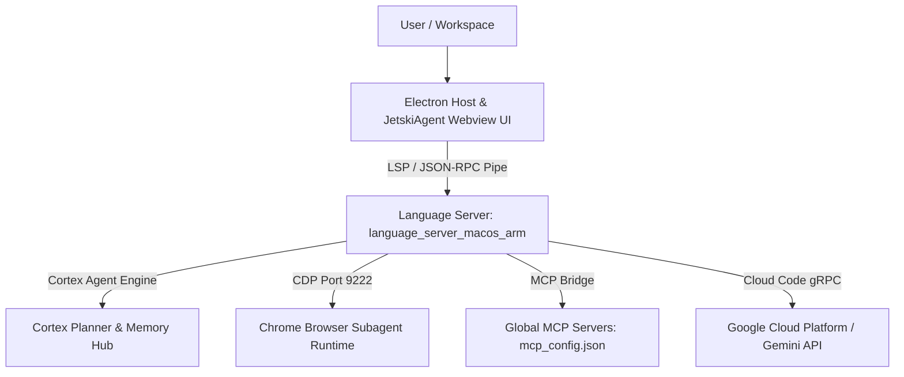

# Antigravity IDE Reverse-Engineering Dossier

**Target**: Google Antigravity IDE (`/Applications/Antigravity IDE.app`, version 2.5.5)  
**Method**: REA Protocol (Mach-O Disassembly, Electron AST Reconstruction, String/Proto Inspection)  
**Standard**: EGE-2 Quantum Epistemic Level 1 (Direct Telemetry & Ground Truth)

---

## 1. Executive Summary & Provenance

Antigravity IDE is Google's advanced agentic coding environment built on a customized Electron/VS Code foundation integrated with an autonomous Go-based AI orchestration engine.

* **Internal Google Monorepo Origin**: `google3/third_party/jetski/`
* **Internal Project Codename**: **`Jetski`** (IDE shell & UI) / **`Cortex`** (AI brain, memory, and planner)
* **Application Bundle**: `/Applications/Antigravity IDE.app` (Bundle ID: `com.google.antigravity-ide`)
* **Upstream Cloud Endpoint**: `https://daily-cloudcode-pa.googleapis.com` (Cloud Code API)

---

## 2. Component Deconstruction

### 2.1 The AI Daemon (`language_server_macos_arm`)
* **Path**: `/Applications/Antigravity IDE.app/Contents/Resources/app/extensions/antigravity/bin/language_server_macos_arm`
* **Format**: Mach-O 64-bit arm64 executable (131 MB).
* **Language & Runtime**: Compiled Go binary with embedded Protocol Buffers and Go template pipelines.
* **Protobuf Definition Namespaces**:
  - `cortex_go_proto`: Manages `AgentMessage`, `CortexMemory`, `NotebookBlob`, `SidecarEvent`, `SubagentSpec`, `TaskSnapshot`, `WorkflowSpec`, `AccumulatedItem`, `ActionDebugInfo`.
  - `cortex_pb/model_native_tool_type_go_proto`: Handles native agent tool declarations (`ask_question`, `run_command`, `write_to_file`, `browser_subagent`).
  - `jetbox_summaries_pb`: Sandboxed execution container telemetry.
  - `project_pb`: Project migration and workspace isolation state.
* **Embedded System Prompt Templates**:
  - `google3/third_party/jetski/prompt/template_provider/templates/system_prompts/conversation_transcript.tmpl`
  - `google3/third_party/jetski/prompt/template_provider/templates/system_prompts/artifacts.tmpl`
  - `google3/third_party/jetski/prompt/template_provider/templates/system_prompts/persistent_context.tmpl`
  - `google3/third_party/jetski/prompt/template_provider/templates/system_prompts/communication_style.tmpl`
  - `google3/third_party/jetski/prompt/template_provider/templates/step_strings/run_command.tmpl`

### 2.2 The Frontend UI & Agent Panel (`jetskiAgent`)
* **Path**: `/Applications/Antigravity IDE.app/Contents/Resources/app/out/jetskiAgent/main.js` (13.9 MB).
* **Architecture**: React / TailwindCSS webview application rendered inside an Electron panel (`jetski-drag-ui-container`).
* **Subsystems**:
  - **Interactive Modals**: Renders `ask_question` forms, permission confirmation dialogs, and progress bars.
  - **Artifact Renderer**: Renders markdown artifacts, mermaid diagrams, and carousel slide decks.
  - **Inline Code Assistant**: Powers `supercompleteAccept` (Tab), multi-hunk diff review (`alt+j`/`alt+k`), and ghost-text inline completion.

### 2.3 The Headless Browser Subagent Bridge
* **Host**: Google Chrome running in the background (`/Applications/Google Chrome.app/Contents/MacOS/Google Chrome`).
* **Flags**: `--remote-debugging-port=9222 --user-data-dir=/Users/malcolm/.gemini/antigravity-browser-profile --disable-fre`.
* **Protocol**: Direct Chrome DevTools Protocol (CDP) WebSocket connection on port 9222.
* **Capabilities**:
  - Native screenshot capturing and WebP video encoding.
  - Pixel-to-pixel drag-and-drop (`browser_drag_pixel_to_pixel`).
  - Active page tracking (e.g. `http://localhost:7700/`).

---

## 3. MCP Subsystem & Schema Invariants

Antigravity IDE enforces a strict internal JSON Schema located at:  
`extensions/antigravity/schemas/mcp_config.schema.json` (synced with `google3/third_party/jetski/cortex/utils/mcp/config.schema.json`).

Supported Server Attributes:
* `command` & `args`: Standard Stdio executable launching.
* `env`: Environment variable overrides (supports `${VAR}` expansion).
* `serverUrl` & `headers`: Remote SSE/HTTP MCP endpoints.
* `tools.<tool_name>.background`: `"always" | "off"` for async background execution.
* `tools.<tool_name>.eager`: `boolean` for eager loading into the initial system prompt namespace without discovery roundtrips.
* `authProviderType`: Supports `"google_credentials"` for automatic Google Cloud ADC injection.

---

## 4. Key Discovery Summary

1. **Dual Identity**: Antigravity IDE is the public, polished packaging of Google's internal **Jetski / Cortex** system.
2. **Deterministic Architecture**: Prompts are not ad-hoc; they are rendered by compiled Go templates within `language_server_macos_arm` and tracked via structured Protocol Buffer event streams.
3. **Deep Browser Integration**: The browser tools are powered by an isolated background Chrome instance via CDP port 9222.
4. **Clean Extension Points**: Custom workflows (`.agents/workflows/`), rules (`.agents/rules/`), global skills (`~/.gemini/config/skills/`), and MCP servers (`mcp_config.json`) are first-class primitives natively wired into Cortex.
